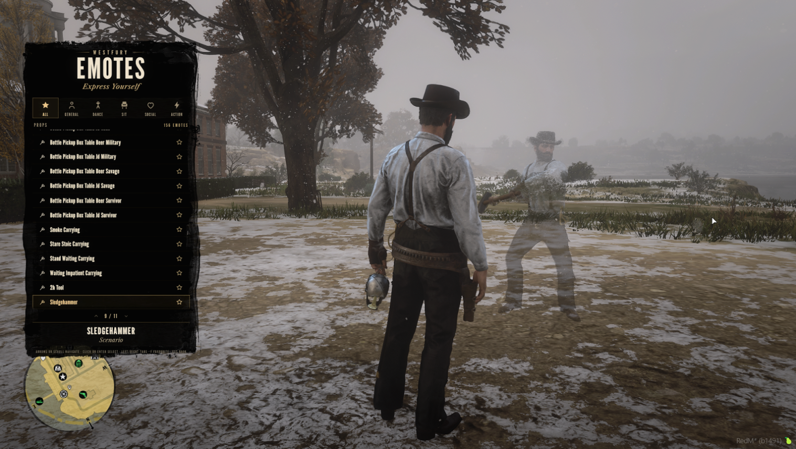
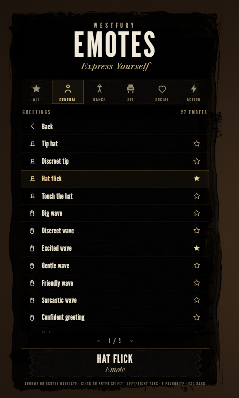
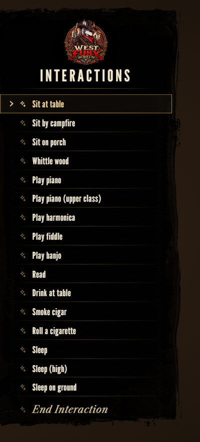

# wf-emote

Standalone emote and world-interaction resource for RedM, built around its own torn-paper book UI: a live 3D preview of every emote, a category-grouped picker for chairs / beds / pianos / baths, per-character favourites and native RDR2 UI sounds. No menu resource, no image pack, no escrow — every file here is editable.

**Version:** 1.1.0 · **Requires:** `oxmysql` · **Framework:** optional (RSG / VORP auto-detected for favourites) · **UI:** built-in NUI

---

## Screenshots



The book in game: the highlighted emote is played by a transparent clone of your character on the right, while the list, icons, favourites and footer stay on the left.

<p>
  
  
</p>

Left: the **F7 emote book** UI on its own — tabs, PNG icons, favourites stars, page counter and a footer describing the highlighted emote. Right: the **world interaction picker** (`J`) — every nearby action grouped under its category header.

---

## Features

- **634 entries** across greetings, gestures, reactions, taunts, dances, stances/posing, sitting, injured, jobs, police, trading, smoking, washing, saloon, music, scenarios, props and custom female poses.
- **Built-in book UI** (`ui/index.html`) — tall dark sheet with WESTFURY / EMOTES branding, six tabs (All, General, Dance, Sit, Social, Action), scrolling lists, PNG icons, favourites stars and an `x / y` page indicator. The right side of the screen stays free for the preview.
- **3D preview** — a transparent local clone of your character performs the highlighted animation beside you, with its own camera, before you commit to it. Selecting plays it on your real character.
- **Favourites per character** — stored in MySQL (`wf_emotes` table, created automatically), starred from the menu with `F` or `/wfefav <command>`.
- **Shared emotes** — handshake, hug, cheer, pair dance (initiator leads / partner follows) and hostage (grab / victim). Both players face each other automatically.
- **World interactions** — walk up to a chair, bench, bed, piano, bath, bucket…, press `J`, preview the scenario, `Enter` to start. Bathing cleans blood and dirt.
- **Grouped interaction list** — nearby actions sit under Chair / Bench / Bed / Piano / Bath headers: wheel or arrows to scroll, click or `Enter` to start, `X` to stop.
- **Native RDR2 UI audio** — both surfaces play the game's own frontend sounds (open, close, navigate, accept, deny) through `PlaySoundFrontend`, and stay quiet on the initial layout pass. Pairs are configurable per surface.
- **Dance clips included** — Macabre's *California Girls* and the 16-part *Thriller* routine are streamed with the resource, alongside the 29 redmorrow female pose clips.
- **Upper-body variants** — `/e <command> upper` plays only the upper body.
- **Framework-light** — core emotes work with no framework; favourites use RSG or VORP when one is started (`WF.Framework = 'auto'`).

---

## Installation

1. Copy the `wf-emote` folder into your server resources.
2. Ensure it starts after `oxmysql` (and after your framework, if you use one):

   ```cfg
   ensure oxmysql
   ensure rsg-core        # or vorp_core — optional
   ensure wf-emote
   ```

3. Start the server. The `wf_emotes` table is created on first boot; no SQL import and no item images needed.
4. Open the book with `F7` (or `/wfemotes`) and walk near a chair to test `J`.

There is nothing else to download: the UI, icons, fonts and streamed clips all ship in this folder.

---

## Controls

### Emote book (F7 / `/wfemotes` / `/poses`)

| Input | Action |
|---|---|
| `F7` | Open / close the book |
| `↑` / `↓`, mouse wheel | Navigate the current list |
| `←` / `→` | Switch tab (All, General, Dance, Sit, Social, Action) |
| `Enter` / click | Play the highlighted emote (or open the section) |
| `F` | Toggle favourite on the highlighted emote |
| `Backspace` / `Esc` | Back, then close |
| `X` | Stop the current animation |

### World interactions (`J` / `/interact`)

| Input | Action |
|---|---|
| Walk near a usable object | Prompt appears |
| `J` | Open / close the picker |
| `↑` / `↓`, mouse wheel | Move through the grouped list |
| `Enter` / click | Start the interaction |
| `X` | Stop the interaction |
| `Esc` | Close the picker |

---

## Commands

| Command | Description |
|---|---|
| `/wfemotes`, `/poses` | Open the emote book |
| `/e <command>` | Play an emote by its command name (e.g. `/e tada`) |
| `/e <command> upper` | Play the upper-body variant |
| `/e c` | Stop the current animation |
| `/wfefav <command>` | Toggle a favourite without opening the menu |
| `/interact` | Open / close the world interaction picker |

Every command in the book is also available as `/e <command>`; the command names are the `Command` field in `animations.lua`.

---

## Emote library

| Category | Entries | Examples |
|---|---:|---|
| greets | 27 | Tip hat, Big wave, Handshake, Fancy bow |
| action | 48 | Point, Beckon, Coin flip, Hip shot |
| trading | 3 | Take notes |
| smoking | 2 | Cigar, Cigarette |
| police | 7 | Hands up, Surrender |
| reaction | 35 | Laugh, Amazed |
| taunts | 22 | Taunts and mock gestures |
| dances | 47 | Waltz, Charleston, California Girls, Thriller 1–16 |
| posing | 23 | Stances and idles |
| sitting | 11 | Sit poses |
| music | 2 | Instrument emotes |
| injured | 18 | Limps, crawls, downed poses |
| saloon | 3 | Bar idles |
| jobs | 4 | Work loops |
| poses | 29 | redmorrow female poses (streamed clips) |
| props | 156 | Tray, newspaper, fiddle, toolbox, baby, basket, fan, parasol, book, candle, tea, champagne, apple |
| scenarios | 191 | Native RDR2 scenarios |
| washing | 1 | Washing |
| shared | 5 | Handshake, hug, cheer, pair dance, hostage |

---

## Configuration

### `config.lua` — the book (`WF`)

| Option | Default | Description |
|---|---|---|
| `WF.OpenKey` | `0x76` (F7) | Virtual key that opens the book |
| `WF.StopKey` | `0x8CC9CD42` (X) | RedM control that stops the animation |
| `WF.Commands.menu` / `.play` / `.fav` | `wfemotes` / `e` / `wfefav` | Chat command names |
| `WF.Framework` | `'auto'` | `auto`, `rsg` or `vorp` for favourites |
| `WF.Preview.enabled` | `true` | Enable the 3D clone preview |
| `WF.Preview.distance` | `2.4` | Distance in front of the player |
| `WF.Preview.alpha` | `105` | Clone transparency (0–255) |
| `WF.Preview.camera` | `true` | Aim a camera at the clone while browsing |
| `WF.Preview.cameraOffset` | `{1.4, -2.6, 0.4}` | Camera offset relative to the player |
| `WF.Preview.aimHeight` | `0.85` | Look-at height above the clone's feet |
| `WF.Preview.sideShift` | `1.45` | Slides the clone to the right of the screen |
| `WF.Preview.fov` | `46.0` | Preview camera FOV |
| `WF.ClipDefaults.BlendIn` / `.BlendOut` | `4.0` / `-4.0` | Blend times for streamed clips |
| `WF.HolsterWeapon` | `true` | Holster before playing a streamed pose |
| `WF.Sound` | see below | Native UI sounds for the book |

### `wf_interact_config.lua` — world interactions (`WFInteract`)

| Option | Default | Description |
|---|---|---|
| `WFInteract.OpenKey` | `J` | Key that opens the picker |
| `WFInteract.StopKey` | `X` | Unified stop key |
| `WFInteract.OpenHoldMode` / `OpenHoldTimeMs` | `false` / `0` | Require holding the open key |
| `WFInteract.TeleportBackOnStop` | `true` | Return to the original spot when stopping |
| `WFInteract.BannedAreas` | `{}` | `{ coords = vector3(...), radius = 5.0 }` zones where nothing can start |
| `WFInteract.NearbyCheckInterval` | `750` | World scan interval (ms) |
| `WFInteract.Marker` | enabled, gold | Marker drawn on the selected target |
| `WFInteract.Theme.position` / `.width` | `right` / `20vw` | Where the picker sits |
| `WFInteract.Theme.fontSize` / `.titleFontSize` | `0.98vw` / `1.7vw` | Typography |
| `WFInteract.Theme.accentColor` | `#d2ae62` | Selection / divider accent |
| `WFInteract.Theme.maxItems` | `250` | Hard cap on listed interactions |
| `WFInteract.Theme.showLogo` / `.logoUrl` / `.logoSize` | `true` / `logo.png` / `4.8vw` | Header artwork |
| `WFInteract.Theme.showCategoryDot` | `false` | Category dots are off — headers group the list instead |
| `WFInteract.CategoryOrder` | chair, bench, bed, piano, bath, misc | Order of the picker category headers |
| `WFInteract.OpenKeyRaw` | `0x4A` (J) | Raw key that closes the picker again |

### UI sounds

Both tables share the same layout and accept any `PlaySoundFrontend` pair:

```lua
WF.Sound = {
    enabled = true,
    open    = { name = 'INFO_SHOW',   set = 'Ledger_Sounds' },
    close   = { name = 'BACK',        set = 'HUD_SHOP_SOUNDSET' },
    navUp   = { name = 'NAV_UP',      set = 'Ledger_Sounds' },
    navDown = { name = 'NAV_DOWN',    set = 'Ledger_Sounds' },
    accept  = { name = 'SELECT',      set = 'HUD_SHOP_SOUNDSET' },
    deny    = { name = 'UNAFFORDABLE', set = 'Ledger_Sounds' },
}
```

`WFInteract.Sound` has the identical shape. Set `enabled = false` to mute either surface.

The book's overall size is one variable: `--em-scale` in `ui/style.css` (`0.78` by default).

---

## Adding your own emote

Everything the book shows comes from `WF.Animations` in `animations.lua`. Add one table entry and it appears in its category automatically:

```lua
-- built-in KIT emote (no dictionary needed)
{ Command = 'salute2', Label = 'Salute', Category = 'greets', Icon = 'wave',
  Type = 'Emote', EmoteType = 'KIT_EMOTE_GREET_SEVEN_1' },

-- animation dictionary + clip
{ Command = 'leanwall', Label = 'Lean on wall', Category = 'posing', Icon = 'person',
  Type = 'Anim', Dict = 'amb_rest_lean@world_human_lean@wall@female_a@idle_b', Body = 'idle_d' },

-- native scenario
{ Command = 'bench', Label = 'Sit on bench', Category = 'sitting', Icon = 'chair',
  Type = 'Scenario', Scenario = 'WORLD_HUMAN_SEAT_BENCH' },

-- streamed .ycd clip (drop the file in stream/)
{ Command = 'pose_new', Label = 'New pose', Category = 'poses', Icon = 'sparkle',
  Type = 'Clip', Dict = 'redmorrow_com@pose99', Body = 'pose99', Flag = 1, UpperFlag = 49 },
```

- `Category` maps to the menu sections; `Icon` is a PNG name in `ui/assets/icons/`.
- `Flag` / `UpperFlag` are only needed for looped streamed clips.
- The same entry is reachable as `/e <Command>`.

World interactions are ordinary tables in `wf_interact_config.lua` / `wf_interact_extra.lua` (object model, scenario or animation, heading, offsets), grouped by category at runtime.

---

## File structure

```
wf-emote/
├── fxmanifest.lua
├── config.lua                  book settings, preview, sounds
├── animations.lua              634 emote entries
├── client.lua                  book, preview clone, /e commands
├── server.lua                  favourites (wf_emotes table, RSG/VORP)
├── wf_interact_config.lua      world interactions + picker theme
├── wf_interact_locales.lua     picker strings
├── wf_interact_utils.lua
├── wf_interact_shared.lua
├── wf_interact_extra.lua       extra interaction tables
├── wf_interact_client.lua      detection, picker, scenario preview
├── stream/
│   ├── macabre@*.ycd           17 dance clips (Macabre)
│   └── redmorrow_com@*.ycd     29 female pose clips (redmorrow)
├── ui/
│   ├── index.html
│   ├── style.css               book + picker styling, --em-scale
│   ├── script.js               tabs, lists, scroll fades, NUI callbacks
│   ├── logo.png
│   └── assets/                 torn paper, grain, fonts, icons/
└── screenshots/
```

---

## Credits and thanks

This resource stands on a lot of published community work. Original credits are kept in the source files on purpose.

- **Fonkas — fks-animations** (GPL-3.0) — animation data ([GitHub](https://github.com/Fonkas/fks-animations)).
- **redmorrow — 30+ Custom Female Poses** — female pose `.ycd` clips streamed from `stream/redmorrow_com@*.ycd` ([docs](https://docs.redmorrow.com/animations/30-female-poses/)).
- **Macabre** — dance clips streamed from `stream/macabre@*.ycd`: *California Girls* and the 16-part *Thriller* routine ([free pack on Tebex](https://macabre-redm.tebex.io/category/free)).
- **femga — rdr3_discoveries** — scenario lists and KIT emote lists ([GitHub](https://github.com/femga/rdr3_discoveries)).
- **kibook — redm-emotes** — solo/shared dance and prop emote data ([GitHub](https://github.com/kibook/redm-emotes)).
- **deadyen — deadyen_emotes** — additional emote data ([GitHub](https://github.com/deadyen/deadyen_emotes)).
- **@cocomonksky** — prop offset research.
- **AxeelWarZ — awz_interactions** — the world interaction system, renamed and stripped down here to `wf-interact` ([GitHub](https://github.com/AxeelWarZ/awz_interactions)).
- **kibook — redm-interactions** — the original interaction concept awz_interactions builds on ([GitHub](https://github.com/kibook/redm-interactions)).
- **Nowimps8 — RedM-info** — native frontend sound names and sound-set pairs ([FrontEndSounds.lua](https://github.com/Nowimps8/RedM-info/blob/master/FrontEndSounds.lua)).
- **Senexis — RedM-Native-Satchel** — behaviour reference for when native UI sounds should fire ([GitHub](https://github.com/Senexis/RedM-Native-Satchel)).
- **Westfury UI asset pack** — emote book art (torn paper, grain, fonts). The emote icons in `ui/assets/icons/` were generated for this resource; the 3D preview technique is inspired by awz_interactions.

Thanks to everyone in the RedM modding community who keeps publishing animation dictionaries, scenario lists and prop offsets openly — this resource would just be a list of guesses without that work.

---

## Notes

- No escrow, no obfuscation; all Lua is readable and editable.
- The menu is a plain NUI page, so it can be restyled without touching Lua.
- Issues and pull requests: [xcode1506/wf-emote-for-rsg](https://github.com/xcode1506/wf-emote-for-rsg).
